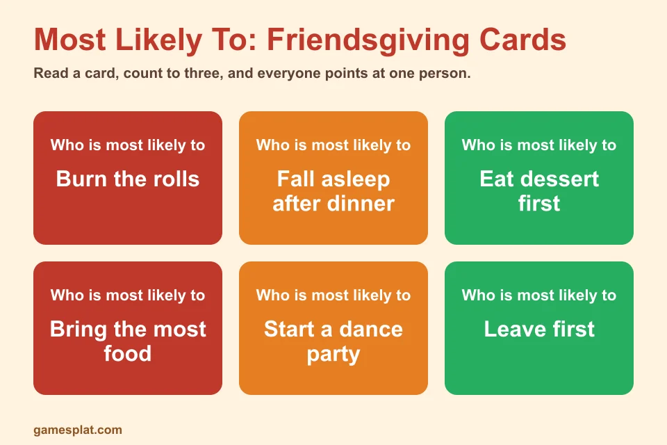
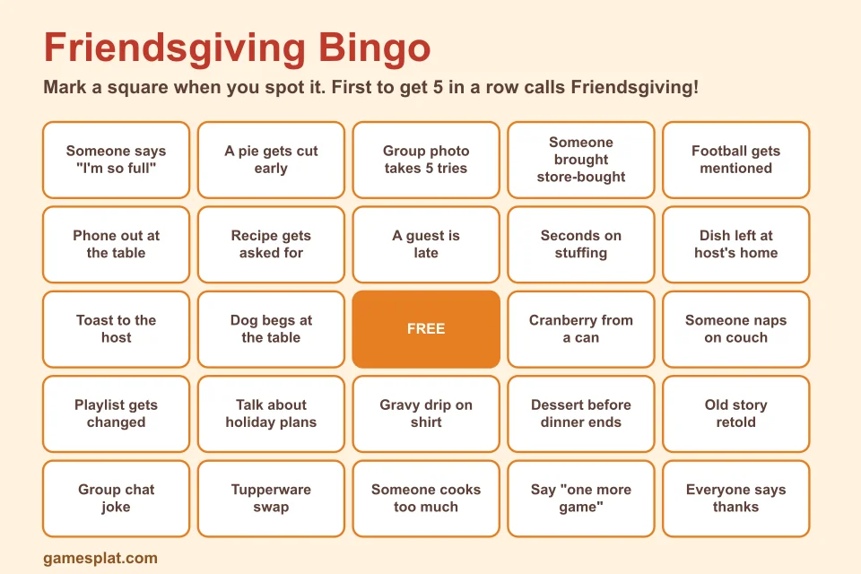

**Last Updated: November 2, 2026**

Friendsgiving has a funny problem. The food is great, the people are great, and then around 8 p.m. everyone ends up scrolling on their phones in the same room. A couple of well-chosen **friendsgiving games** fix that fast. They give the group something to laugh about together and, more importantly, they get people talking to each other.

We put together 15 games for adults that don't need much planning, and none of them rely on drinking. You can add a glass of wine if that's your crowd, but you won't need it. If you're hosting a mixed-age Thanksgiving instead, take a look at our [Thanksgiving games for the whole family](/articles/thanksgiving-games-for-family), or try the quick [Thanksgiving minute to win it games](/articles/thanksgiving-minute-to-win-it-games) for something shorter and sillier.

## How to Choose the Right Friendsgiving Game

Not every game suits every group. A few things to think about before you pick:

- **How well do your guests know each other?** If it's mostly strangers, start with something gentle like bingo. Close friends can handle roasting each other in Most Likely To.
- **How many people are coming?** Charades and trivia scale well. White elephant gets chaotic past 15, which is either a problem or a feature.
- **How much space and time do you have?** Seated games work around a dining table. Active ones need a living room.
- **What's the energy level?** After a heavy meal, a quiet game often beats a loud one.

A simple plan is one game before dinner, one after, and a third only if people are still up for it.

## 15 Friendsgiving Games for Adults

### 1. Friendsgiving Trivia

Write 15 to 20 questions about the group itself. Where did two of the guests first meet? Who has moved the most times? Which person once showed up to a party with the wrong date? Guests write their answers on paper, and the host reads out the right ones.

It works because it's personal. Anyone can google Thanksgiving facts, but only your friends know the answers to these.

### 2. White Elephant Gift Swap

Each guest brings one wrapped gift under a set limit, usually $15 to $20. Players draw numbers. Number one opens a gift. The next person either opens a new one or steals an already-opened gift. A gift can be stolen up to two or three times before it's locked.

Agree on the rules before you start. Most arguments in this game come from people remembering the steal limit differently.

### 3. Most Likely To

Read a prompt, count to three, and everybody points at the person they think fits best. Try "Who is most likely to burn the rolls?" or "Who would fall asleep before dessert?" Keep it kind, and avoid prompts that could really embarrass someone.

### 4. Two Truths and a Lie: Year in Review

Each player shares two true things and one lie about their past year. The rest of the group guesses the lie. Because everyone has had a strange year, the true statements are usually harder to believe than the false one.

### 5. Thanksgiving Charades

Write Thanksgiving-themed words on slips of paper: gravy boat, cranberry sauce, parade balloon, food coma, burnt rolls, turkey trot. Split into two teams and give each person 60 seconds to act out as many as they can.

Adults tend to get surprisingly competitive about charades, so keep score.

### 6. Paper Tablecloth Pictionary

Cover the table with white butcher paper and set out some markers. One person draws a word card, and everyone shouts guesses. At the end you'll have a ridiculous piece of art to keep.

### 7. Friendsgiving Awards

Make a list of silly award categories: Best Dish, Most Creative Plate, Best Leftover Plan, Quietest Eater, Best Dressed Pumpkin. Everyone votes on a slip of paper, and the host hands out dollar-store trophies or paper certificates at the end of the night.

It's less a game and more a ritual, and people remember it.

### 8. Phone Scavenger Hunt

Give the group a list: a photo of something orange, a selfie with the host, a picture of the weirdest dish, a shot of three people holding a pie. Teams have 20 minutes to send in their photos. The best team wins a prize, and everyone gets a camera roll full of memories.

### 9. Guess the Dish

Guests each bring a dish. Before dinner, pour tiny tastes of a few items into cups and have people guess what's in them. The challenge: sweet potato casserole and pumpkin pie look similar when blended. It's fun, and it gets people to try each other's cooking.

### 10. Heads Up, Friendsgiving Edition

Use a free phone app or paper cards. One person holds a card on their forehead while others give clues. Change the categories to Thanksgiving foods, movie characters or things that annoy you in a crowded kitchen.

### 11. Never Have I Ever (No-Drink Version)

Everyone holds up five fingers. Someone says "Never have I ever…" and anyone who has done it puts a finger down. The last person with a finger up wins. Use clean-ish topics, like "Never have I ever eaten leftovers for breakfast on three days in a row."

### 12. Name That Tune

Build a short playlist of one-liner clips from songs that match a theme, such as the 2000s, movie soundtracks or anything that mentions food. Play ten seconds of each song and let teams shout the title and artist. Hosts can use any streaming app.

### 13. Table Topics

Put a stack of question cards in a jar and pass it around the table. Questions like "What's the best meal you've ever eaten?" or "What are you quietly proud of this year?" get surprisingly honest. It's the most low-key game on the list and often the most memorable.

### 14. Friendsgiving Bingo

Hand out bingo cards filled with the small things that happen at every get-together: someone says "I'm so full," the group photo takes five tries, a dish gets rediscovered at midnight. Mark squares as you spot them. The first person to get five in a row wins.

You can screenshot the card above, or copy the squares onto your own paper cards and mix up the order for each guest.

### 15. Secret Mission Cards

Give each guest a private mission on a folded card. For example, "get three people to say the word 'pie'," or "start a toast without being asked." Players try to complete the mission without anyone noticing. At the end of the night, everyone reveals theirs.

It's a nice way to get quieter guests moving around the room, because they have a task to complete.

## Free Printable: Friendsgiving Bingo

The bingo card above is free to use. Screenshot or save it, print one copy for each guest, and hand out pens at the door. You can also change the squares to match your own group. Adding a few inside jokes makes it much more fun.

## Hosting Tips That Save the Night

**Don't announce the games too early.** Let people eat and relax, then bring the games out when the energy is right.

**Keep the prizes small.** A bottle of hot sauce, a candle or a scratch-off ticket is enough. The point is the laughs.

**Rotate games every 15 to 20 minutes.** Nobody wants to play one game for two hours.

**Have a backup.** If a game flops, move on without apologizing. Someone will suggest charades anyway.

**Ask a friend to co-host the games.** That way you can enjoy dessert instead of running the scoreboard.

## Frequently Asked Questions

### What are good Friendsgiving games for adults?

Friendsgiving Trivia, a white elephant gift swap, Most Likely To, Two Truths and a Lie and Thanksgiving charades are reliable favorites. They need almost no setup and work for groups of six to twenty.

### Do Friendsgiving games need alcohol?

No. Every game here works with cider, coffee or water. If your group likes a drink, you can add a simple twist to most of them, but the fun comes from the people, not the drinks.

### When should we play games at Friendsgiving?

The best times are while the food rests before dinner, or an hour after eating when everyone is full and relaxed. Avoid playing during the meal, because hot food and games don't mix.

### How do I get shy guests to join in?

Start with low-pressure games like Friendsgiving Bingo or the Guess the Dish game, where nobody has to perform. Save louder games like charades for later, once people are comfortable.

### How many games should I plan for Friendsgiving?

Three or four is plenty. Pick one icebreaker, one group game, one gift swap or contest, and one backup in case the first ones fall flat.

## More Party Ideas

Planning more than one event this season? Browse our [party games](/categories/party-games) for ideas, or look ahead to the holidays with our [Christmas party games for kids](/articles/christmas-party-games-kids) if there are children joining the next gathering. Share your own Friendsgiving photos with us on [Pinterest](https://www.pinterest.com/gamesplatcom/) or [Facebook](https://www.facebook.com/gamesplatcom).
