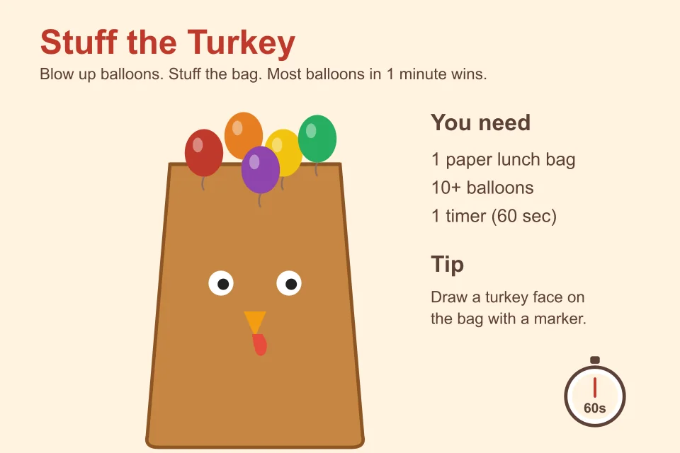
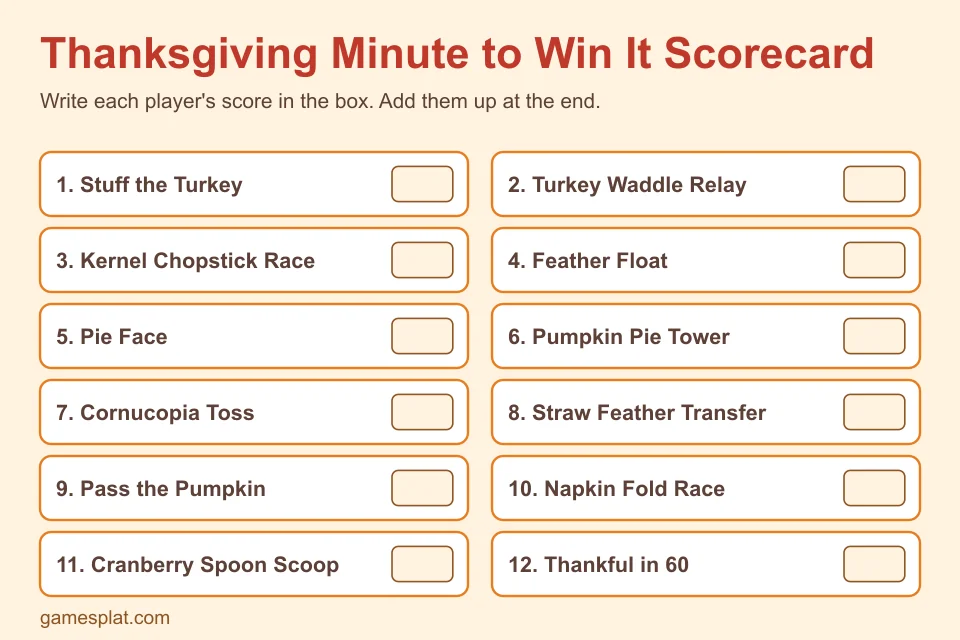

**Last Updated: November 1, 2026**

Thanksgiving dinner takes hours to cook and about fifteen minutes to eat, and somewhere in between there's a long, awkward stretch where everybody stands in the kitchen. That's where **thanksgiving minute to win it games** earn their spot on the schedule. Each challenge lasts one minute, the rules fit in two sentences, and the supplies come from your kitchen drawer.

We picked 12 that work for kids, adults and mixed crowds. They're easy to set up, they're loud in the good way, and none of them need a trip to a party store. If you want longer games for the whole group, our list of [20 Thanksgiving games for the whole family](/articles/thanksgiving-games-for-family) covers that, and the [15 Thanksgiving games for kids](/articles/thanksgiving-games-for-kids) are better for classrooms. Everything below is new, so you won't see the same game twice.

## How Minute to Win It Games Work

The idea is simple. You have 60 seconds to finish one odd little task. Complete it and you win the round, or score points for how much you finish before time runs out.

A few things make the day run smoothly:

- **Set up all the stations first.** Lay out each game on a table before anyone arrives, so you're never hunting for a cup mid-game.
- **Use a phone timer that everyone can see.** Arguments about "was that a minute?" kill the fun fast.
- **Pick a scorekeeper.** Use our free scorecard below, or just a sheet of paper.
- **Decide the prize before you start.** A pie slice, bragging rights, or first pick of the leftovers all work.

## 12 Thanksgiving Minute to Win It Games

### 1. Stuff the Turkey

Give each player a paper lunch bag with a turkey face drawn on it, plus a pile of balloons. In one minute, they blow up balloons and stuff as many as they can into the bag. The player with the most balloons inside wins.

Heads up: sixty seconds of blowing up balloons is tiring. Pre-inflate a few for younger kids, or let them use a hand pump.

### 2. Turkey Waddle Relay

Put a balloon between the player's knees. They waddle from one side of the room to the other without using their hands, then waddle back. If the balloon drops, they start again from the beginning. Best time wins.

It looks ridiculous, which is exactly why people love it. This is one of the better thanksgiving party games for kids and grandparents who want to watch.

### 3. Kernel Chopstick Race

Put a pile of candy corn (or popcorn kernels) on a plate and an empty cup beside it. Using only chopsticks, the player moves as many pieces as they can into the cup in one minute. Tweezers are an easier option for little hands.

### 4. Feather Float

Give each player one craft feather. Their job is to keep it in the air for 60 seconds by blowing on it, without touching it. If it hits the floor, the clock keeps running, so they have to grab it and carry on.

You can also play it as a team challenge, where each person gets a feather and the group has to keep all of them up at once.

### 5. Pie Face

This one is for the brave. Spread whipped cream on a plate and hide a candy corn in it. With hands behind their back, the player has to find and pull out the candy corn using only their face. Fastest time wins.

Put a towel under the plate and keep wet wipes nearby. It's messy, and you will end up with a lot of photos.

### 6. Pumpkin Pie Tower

Hand each player a stack of 10 to 12 mini pie tins or paper plates. They have one minute to build the tallest tower that stays standing for five seconds. Wobbly towers are half the entertainment.

### 7. Cornucopia Toss

Place a basket on its side to act as the cornucopia and set it about six feet away. Players get ten ping pong balls or scrunched-up paper "fruits" and try to throw them in. The most in 60 seconds wins.

Make the game harder by making each player stand farther back after every round.

### 8. Straw Feather Transfer

Each player gets a drinking straw and a pile of small craft feathers. By sucking on the straw, they lift one feather at a time from a plate and drop it into a bowl. Most feathers in a minute wins.

It's trickier than it sounds, and the faces people make while concentrating are worth the price of admission.

### 9. Pass the Pumpkin

Teams line up. Using a spoon held in the mouth, each person passes a mini pumpkin (or a large orange pom-pom) to the next player in line without using their hands. Drop it and you restart the pass. See which team can get it to the end first.

### 10. Napkin Fold Race

Give each player a stack of cloth or paper napkins. In one minute, they fold as many as they can into a neat fan or turkey shape. Judge by quality as well as quantity, which gives slower, neater players a fair shot. If your table needs setting anyway, you may as well put the winners' work to use.

### 11. Cranberry Spoon Scoop

Fill a bowl with dried cranberries (or marshmallows) and give each player a plastic spoon and an empty cup. They scoop and transfer as many as they can, holding the spoon between their teeth. No hands allowed.

### 12. Thankful in 60

This one needs no supplies. Each player has one minute to name as many things as they're thankful for as they can, without repeating one. Another person keeps count.

It starts as a silly race and often ends with someone saying something sweet. That's a nice way to close the round, and it works for every age.

## Free Printable Scorecard

Keeping score on a napkin gets messy. Use the scorecard below to track each player's results across all 12 games, then add the numbers at the end.

Right-click the image to save it, or take a screenshot and print it. You can also copy the game names onto a plain sheet of paper if you prefer to keep it handwritten.

## Tips for Hosting a Smooth Game Night

**Match the games to the guests.** Messy games like Pie Face are great for teenagers and adults. Younger kids do better with Feather Float, Cornucopia Toss and Thankful in 60.

**Mix active and quiet games.** After Turkey Waddle Relay everyone will want to sit down, so slot in something calm like the Napkin Fold Race.

**Run two stations at once.** If you have more than eight people, two copies of each game halves the waiting time.

**Keep the prizes small.** A chocolate, a mini pie or the right to choose the next movie is plenty. People get competitive enough already.

**Don't force anyone.** A few people would rather cheer from the couch, and that's fine. Give them the timer or the scorecard so they're part of the action.

## Supplies Checklist

Here's everything you might need across all 12 games:

- Phone timer
- Balloons (about 30)
- Paper lunch bags
- Candy corn or popcorn kernels
- Chopsticks or tweezers
- Craft feathers
- Whipped cream and paper plates
- Mini pie tins or paper plates
- Basket and ping pong balls
- Drinking straws
- Plastic spoons and cups
- Napkins
- Dried cranberries or marshmallows
- A mini pumpkin or orange pom-pom

Most of it costs a few dollars, and you can skip anything you don't have, since each game stands alone.

## Frequently Asked Questions

### What are Thanksgiving Minute to Win It games?

They're short challenges where each round lasts 60 seconds or less. A player tries to complete a silly task, like stuffing balloons into a paper bag or moving candy corn with chopsticks, before the timer ends. They use everyday supplies and need almost no setup.

### What do I need for Thanksgiving Minute to Win It games?

A timer is the only must-have. Most games use things you already own: balloons, paper lunch bags, plastic cups, spoons, napkins, straws, candy corn and a few craft feathers.

### How many people can play?

Two players is enough for a head-to-head race. For a bigger group, run each game as a tournament, let teams take turns, or have everyone play at the same time with a scorekeeper.

### Are these games good for kids and adults together?

Yes. Feather Float, Cornucopia Toss and Thankful in 60 suit mixed ages. Messier games like Pie Face are better for older kids and adults, and you can swap in easier versions for little ones.

### How long does a full set of 12 games take?

Each game is 60 seconds, but once you explain the rules and reset, plan on about 5 minutes per game. A full set takes around an hour. Pick five or six for a quick 30 minute round.

## Keep the Fun Going

Once these are done, try something sit-down. Our [indoor recess classroom games](/articles/indoor-recess-classroom-games) have quiet ideas that adapt to a living room, and if you're already thinking ahead to December, the [Christmas party games for kids](/articles/christmas-party-games-kids) use many of the same cheap supplies. You can browse more in our [party games category](/categories/party-games).

Have a favorite we missed? Tell us on [Pinterest](https://www.pinterest.com/gamesplatcom/) or [Facebook](https://www.facebook.com/gamesplatcom), and happy Thanksgiving.
