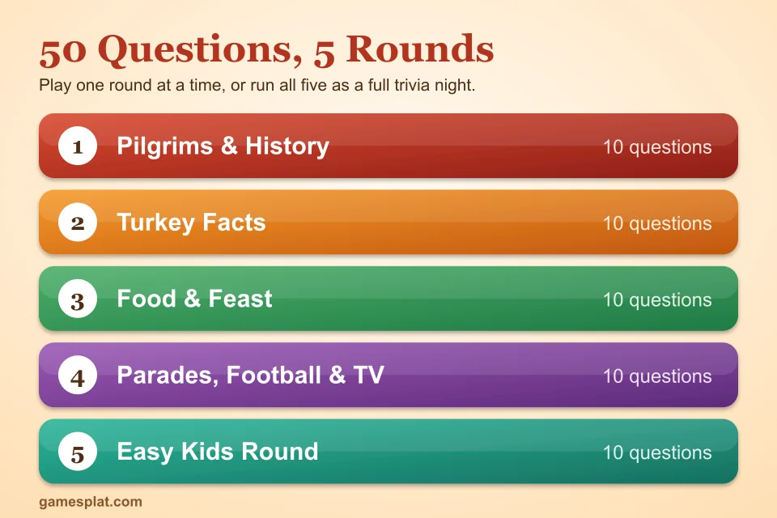
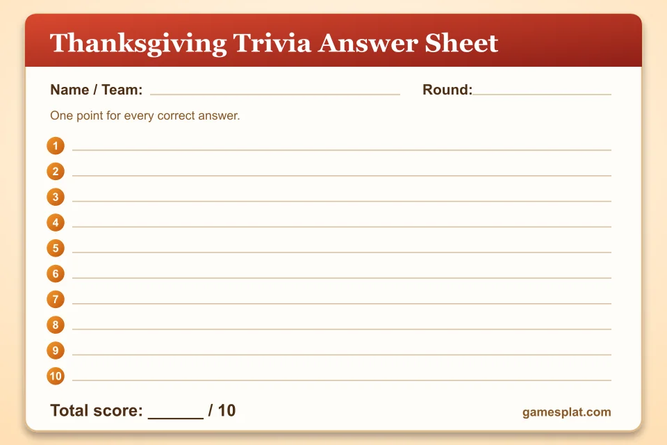

**Last Updated: November 3, 2026**

Every Thanksgiving there's a moment right after dinner when everyone is too full to move and too awake to nap. That's the perfect time for a quick quiz. These **thanksgiving trivia questions** are split into five short rounds, so you can play one round over dessert or run all five as a full family trivia night.

There are 50 questions in total, from easy ones that a six-year-old can get to a few that will stump the grown-ups. Every question comes with an answer key at the bottom of the page, and there's a free printable answer sheet if you'd like to play with teams. If you want games to go with the quiz, try our [Thanksgiving games for the whole family](/articles/thanksgiving-games-for-family) or the [Thanksgiving games for kids](/articles/thanksgiving-games-for-kids).

## How to Play Thanksgiving Trivia

Playing is easy. One person is the quiz host and reads each question aloud. Everyone else writes an answer on their sheet. Once the round is done, the host reads the answers and players check their own score. One point for every right answer.

A few ideas that make it more fun:

- **Play in teams.** Two to four people per team works best, and it gives younger kids a chance to win with help.
- **Set a 20-second timer.** It keeps the game moving and cuts down on googling.
- **Keep a running scoreboard.** Add up the totals after each round, and crown the champion at the end.
- **Have the host skip any questions that are too hard.** Nobody minds, and the game flows better.

## Round 1: Pilgrims & History

These thanksgiving history trivia questions are a good warm-up for older kids and adults.

1. In what year did the Pilgrims and the Wampanoag share the harvest feast we call the "first Thanksgiving"?
2. What was the name of the ship that carried the Pilgrims to America?
3. Which Native American people shared the 1621 feast with the Pilgrims?
4. In which present-day state did the Pilgrims settle?
5. Which US president declared a national day of Thanksgiving in 1863?
6. Which writer, who also wrote "Mary Had a Little Lamb," campaigned for years to make Thanksgiving a national holiday?
7. Thanksgiving falls on which day of the week and month in the United States?
8. Which president tried to move Thanksgiving a week earlier in 1939?
9. About how long did the 1621 harvest celebration last?
10. In which month does Canada celebrate Thanksgiving?

## Round 2: Turkey Facts

Everything you wanted to know about the bird on the table.

11. What is a male turkey called?
12. What is a baby turkey called?
13. Which turkeys make the "gobble" sound, males or females?
14. Which Founding Father wrote in a letter that the turkey was a more respectable bird than the bald eagle?
15. Which president officially began the White House turkey pardon in 1989?
16. True or false: wild turkeys can fly.
17. Where do wild turkeys sleep at night?
18. What is the flap of red skin that hangs under a turkey's beak called?
19. About how fast can a wild turkey run?
20. What do you call a group of turkeys?

## Round 3: Food & Feast

This is the round that makes everybody hungry.

21. Which red berry grows in bogs and gets made into a Thanksgiving sauce?
22. What is the main ingredient in a traditional pumpkin pie?
23. Which US state grows the most cranberries?
24. Which orange vegetable is often baked with marshmallows on top?
25. What do you call the bread mixture that goes inside or alongside the turkey?
26. What sauce do people pour over turkey and mashed potatoes?
27. True or false: mashed potatoes were definitely served at the first Thanksgiving.
28. Which Thanksgiving dessert is made with a filling of pecans?
29. Which frozen meal was invented in 1953 after a company ended up with a huge pile of leftover Thanksgiving turkey?
30. Which fruit is pressed to make the cider many families drink at Thanksgiving?

## Round 4: Parades, Football & TV

Pop culture questions for the sofa crowd.

31. In which city is the Macy's Thanksgiving Day Parade held?
32. In what year did the Macy's parade first take place?
33. Which cartoon cat was one of the first giant balloons in the parade in 1927?
34. Which two NFL teams traditionally play at home on Thanksgiving Day?
35. In "A Charlie Brown Thanksgiving," which dog helps cook the meal?
36. What do people call the Friday after Thanksgiving, known for big sales?
37. What do people call the sleepy feeling after a huge Thanksgiving dinner?
38. Two people pull on this turkey bone to make a wish. What is it called?
39. What is the shopping day on the Monday after Thanksgiving called?
40. Which holiday character traditionally ends the Macy's parade?

## Round 5: Easy Kids Round

These thanksgiving trivia questions for kids are short and simple, so even little ones can join in.

41. What month is Thanksgiving in the United States?
42. What bird is the star of the Thanksgiving dinner?
43. What orange fruit do we carve for Halloween and bake into a pie for Thanksgiving?
44. What color are cranberries?
45. What sound does a turkey make?
46. What word describes the feeling of being grateful for something?
47. What do we call the horn-shaped basket filled with fruits and vegetables?
48. What do we call a big shared meal with family and friends?
49. True or false: turkeys have feathers.
50. What day of the week is Thanksgiving?

## Free Printable Answer Sheet

Give each player or team a copy of this answer sheet so they can write down their answers for each round. Save the image or take a screenshot and print as many copies as you need. One sheet covers a round of ten questions.

## Thanksgiving Trivia Answer Key

**Round 1: Pilgrims & History**

1. 1621
2. The Mayflower
3. The Wampanoag
4. Massachusetts (the Plymouth colony)
5. Abraham Lincoln
6. Sarah Josepha Hale
7. The fourth Thursday of November
8. Franklin D. Roosevelt
9. Three days
10. October (the second Monday)

**Round 2: Turkey Facts**

11. A tom (also called a gobbler)
12. A poult
13. Males
14. Benjamin Franklin
15. George H. W. Bush
16. True. Wild turkeys can fly short distances, though farm turkeys usually can't.
17. In trees
18. A wattle
19. About 25 miles per hour
20. A flock (sometimes called a rafter)

**Round 3: Food & Feast**

21. Cranberry
22. Pumpkin
23. Wisconsin
24. Sweet potatoes
25. Stuffing (also called dressing)
26. Gravy
27. False. Historians think the meal included venison and wild birds, but there's no exact menu.
28. Pecan pie
29. The TV dinner
30. Apples

**Round 4: Parades, Football & TV**

31. New York City
32. 1924
33. Felix the Cat
34. The Detroit Lions and the Dallas Cowboys
35. Snoopy
36. Black Friday
37. A food coma (or turkey coma)
38. The wishbone
39. Cyber Monday
40. Santa Claus

**Round 5: Easy Kids Round**

41. November
42. The turkey
43. A pumpkin
44. Red
45. Gobble
46. Thankful
47. A cornucopia
48. A feast
49. True
50. Thursday

## Ways to Mix Up Your Trivia Night

**Make it a lightning round.** Read the questions fast and give each team five seconds to answer.

**Add a bonus question.** Ask something personal at the end, like "Which person at the table has hosted Thanksgiving the most times?" It's a fun way to end the night.

**Let kids host a round.** Hand the questions to an older child and let them be the quiz master. They'll feel very important.

**Combine with another game.** Play a round of trivia, then break for the quick challenges in our [Thanksgiving minute to win it games](/articles/thanksgiving-minute-to-win-it-games). If your guests are adults, the [Friendsgiving games for adults](/articles/friendsgiving-games-for-adults) go nicely alongside.

## Frequently Asked Questions

### How many Thanksgiving trivia questions should I use?

Ten questions per round works well, and most groups enjoy two or three rounds. If you want a full trivia night, play all five rounds, which takes about 45 minutes.

### Are these Thanksgiving trivia questions good for kids?

Yes. Round 5 is made for younger kids with simple questions, and rounds 2 and 3 work for school-age children. Rounds 1 and 4 get harder, which suits teens and adults.

### How do I play Thanksgiving trivia in teams?

Split the group into teams of two to four. Read each question aloud, give teams 20 seconds to write an answer on the sheet, then reveal the answer and score one point per correct answer.

### Can I print these Thanksgiving trivia questions?

Yes. Copy the questions into a document, or use the printable answer sheet from this page. Keep the answer key to yourself, or print it separately for the quiz host.

### What is a good prize for Thanksgiving trivia?

Small things work best: a slice of pie, first pick of the leftovers, a candle or a silly trophy. The bragging rights are usually the real prize.

## Keep Playing

Looking for more ways to keep everyone busy before and after dinner? Browse our [family games](/categories/family-games), or share your trivia night photos with us on [Pinterest](https://www.pinterest.com/gamesplatcom/) and [Facebook](https://www.facebook.com/gamesplatcom). Happy Thanksgiving!
